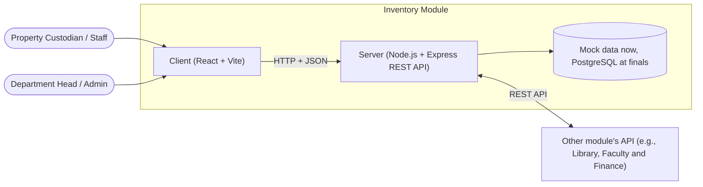
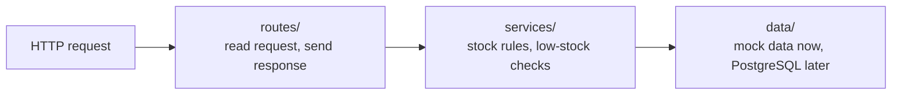

1. Overview
The Inventory module is one of the eight modules of the College Management System. This module allows storekeepers to track campus supplies and equipment, issue items to departments, and receive low-stock alerts for reordering. We used JWT(JSON Web Token) for secure authentication of the admin and Swagger UI for API documentation and CRUD for testing. It consists of a React cleint that users interact with a Node.js + Express REST API that handles the business logic.

2. System Context

3. Building Blocks

| Part | Technology | What it does | Where it lives |
|------|------------|--------------|----------------|
| Client | React + Vite | The screens users see. Calls the API | `frontend/` |
| Server | Node.js 22 + Express | Business rules. Provides the REST API | `backend/` |
| API contract | OpenAPI 3.0 + Swagger UI | Lists every endpoint | `backend/openapi.yaml` |
| Data | Mock data (midterm), PostgreSQL (finals) | Stores items, warehouses, stock levels, issuances | `backend/src/data/` |

4. Backend Layers

Every request goes through the layers in this order, and no layer is skipped. When PostgreSQL is added at finals, only `data/` changes. Routes and services stay the same.

5. Frontend Structure

| Screen | URL in the app | Who can see it | Endpoints used |
|--------|----------------|----------------|----------------|
| Item list | `/items` | Everyone | `GET /items` |
| Item details and stock per warehouse | `/items/:id` | Everyone | `GET /items/{id}` |
| Add item form | `/items/new` | Warehouse staff, Admin | `POST /items` |
| Issue item form | `/issuances/new` | Warehouse staff | `POST /issuances` |
| Low-stock alerts | `/low-stock` | Warehouse staff, Admin | `GET /items/low-stock` |

7. Cross-Cutting Concerns

| Concern | How we handle it |
|---------|------------------|
| Configuration | Environment variables (`.env`). See `backend/.env.example` |
| Input validation | Validation in the routes layer before the request reaches services |
| Error handling | Every error returns Problem Details JSON (see `backend/API-CONTRACT.md`) |
| Logging | Log every request and every error to the console |
| Authentication | Not in midterm. Planned: login with role-based access (staff vs admin) |
| CORS | The server allows only the URLs in `CORS_ORIGINS` |

8. Deployment
Not applicable yet.

9. Known Limitations and Future Work
No database yet.
Real-time stock updates are planned for finals.