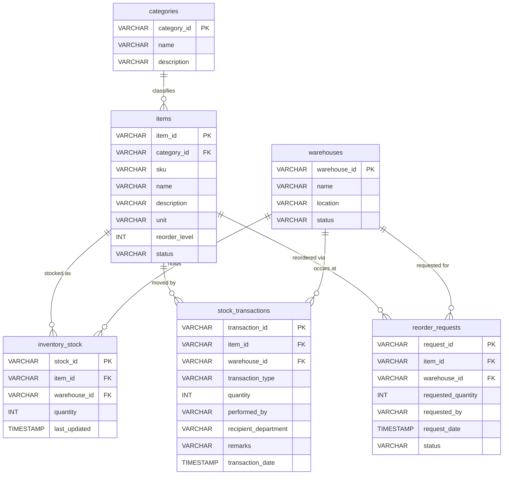

# Data Model

## 1. Overview

The Inventory Management System backend uses PostgreSQL as its relational database.

The database schema is defined in:

`server/database/inventory_schema.sql`

The database contains six main tables:

- `categories`
- `items`
- `warehouses`
- `inventory_stock`
- `stock_transactions`
- `reorder_requests`

The schema defines primary keys, foreign keys, check constraints, and indexes to maintain data integrity and improve query performance.

## 2. Entity Relationship Diagram (ERD)

The following ERD shows the six database tables, their columns, primary keys (PK), foreign keys (FK), and the relationships defined in the PostgreSQL schema.

### Relationship Explanations

- **Categories and Items:** One category can contain multiple items. Each item belongs to one category.
- **Items and Inventory Stock:** One item can have stock records in multiple warehouses. Each stock record references one item.
- **Warehouses and Inventory Stock:** One warehouse can hold stock for multiple items. Each stock record references one warehouse. The combination of `item_id` and `warehouse_id` is unique.
- **Items/Warehouses and Stock Transactions:** An item and a warehouse can each be referenced by many stock transactions. Each transaction references one item and one warehouse.
- **Items/Warehouses and Reorder Requests:** An item can have multiple reorder requests over time. Each request references one item and one warehouse.

### Employee References

The `stock_transactions` and `reorder_requests` tables contain `performed_by` and `requested_by`.

These fields hold an employee identifier from the HR module. The database schema does not define foreign-key constraints for them because employee records belong to another module.

## 3. Table Descriptions## 3. Table Descriptions

| Table | Purpose |
|---|---|
| `categories` | Groups items into types such as office supplies, cleaning supplies, or equipment. |
| `items` | Stores item details, SKU, unit of measure, and the reorder threshold. |
| `warehouses` | Stores campus warehouse and storage location details. |
| `inventory_stock` | Stores the current quantity of each item in each warehouse. |
| `stock_transactions` | Records every stock movement: receiving, issuing, transfers, and adjustments. |
| `reorder_requests` | Records restock requests raised when an item falls to or below its reorder level. |

## 4. Primary Keys and Foreign Keys

Primary keys uniquely identify records in each table. Foreign keys connect records between tables and enforce referential integrity.

| Table | Primary Key | Foreign Key |
|---|---|---|
| `categories` | `category_id` | None |
| `items` | `item_id` | `category_id` references `categories.category_id` |
| `warehouses` | `warehouse_id` | None |
| `inventory_stock` | `stock_id` | `item_id` references `items.item_id`; `warehouse_id` references `warehouses.warehouse_id` |
| `stock_transactions` | `transaction_id` | `item_id` references `items.item_id`; `warehouse_id` references `warehouses.warehouse_id` |
| `reorder_requests` | `request_id` | `item_id` references `items.item_id`; `warehouse_id` references `warehouses.warehouse_id` |

## 5. Constraints and Indexes

The database schema uses check constraints to validate values such as:

- Item and warehouse status.
- Stock quantity (cannot be negative).
- Transaction type (`RECEIVE`, `ISSUE`, `TRANSFER`, `ADJUSTMENT`) and transaction quantity.
- Reorder level (cannot be negative) and requested quantity (must be positive).
- Reorder request status.

Unique constraints apply to `items.sku`, `categories.name`, and the `item_id` + `warehouse_id` pair in `inventory_stock`.

Foreign-key rules specify how related records behave when referenced records are updated or deleted.

Indexes are defined to support queries involving items, categories, warehouses, transaction dates, transaction types, and reorder request statuses.

Refer to `server/database/inventory_schema.sql` for the complete column definitions, constraints, and index declarations.

## 6. API and Data Model Consistency

The API specification is maintained in `server/openapi.yaml`.

The API documentation and database schema should remain consistent regarding identifiers, fields, data types, and validation rules. API response properties may use different naming conventions from database columns when the backend maps between them.

For example, the items API may expose camelCase properties such as `itemId`, `categoryId`, and `reorderLevel`, while the database uses snake_case column names. Likewise, `performedBy` in the stock transactions API maps to the `performed_by` column.
